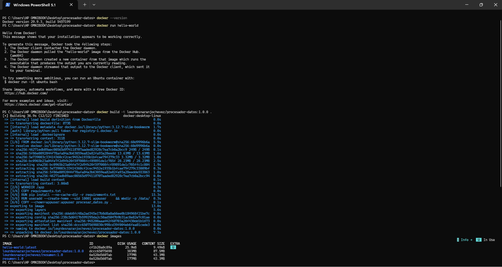
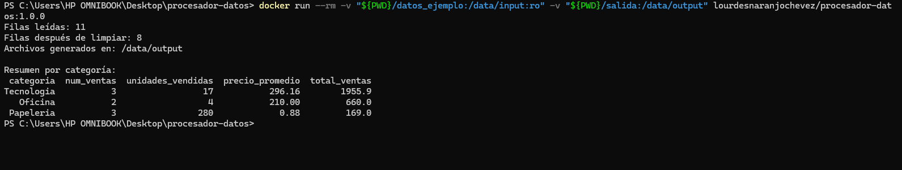
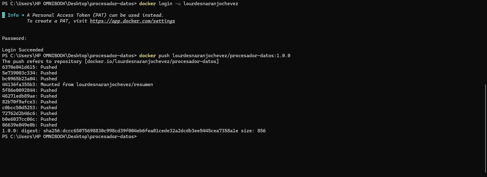
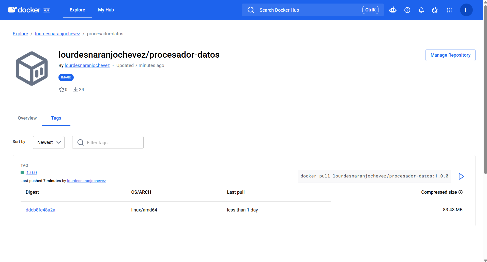
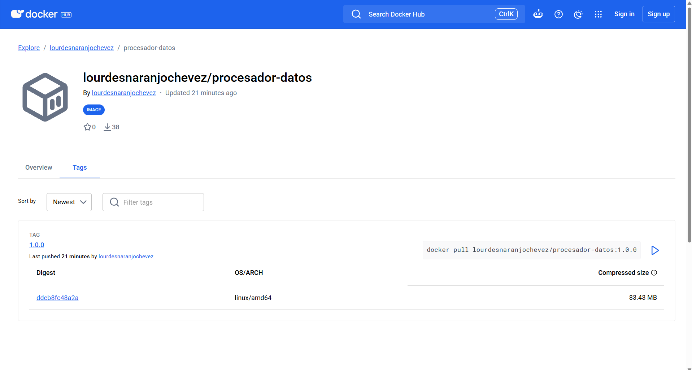
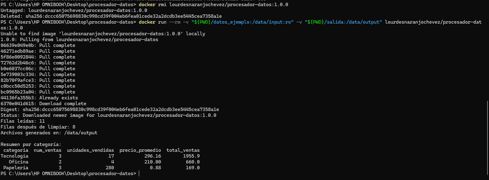

# Procesador de datos de ventas en Docker

Script en Python (pandas) que lee un CSV de ventas, lo limpia (espacios, mayúsculas, duplicados, valores vacíos o inválidos), calcula el total por venta y genera estadísticas por categoría. Está empaquetado en una imagen Docker para que funcione igual en cualquier computadora.

- **Imagen en Docker Hub:** https://hub.docker.com/r/lourdesnaranjochevez/procesador-datos
- **Versión publicada:** `1.0.0`

## Evidencia de publicación

- Repositorio en Docker Hub: https://hub.docker.com/r/lourdesnaranjochevez/procesador-datos
- Etiqueta de versión publicada: `1.0.0`
- Comando para descargarla: `docker pull lourdesnaranjochevez/procesador-datos:1.0.0`

**1. Construcción de la imagen (`docker build`)**



**2. Ejecución local del contenedor**



**3. Publicación en Docker Hub (`docker push`)**



**4. Etiqueta `1.0.0` visible en Docker Hub**



**5. El repositorio es público (visto sin iniciar sesión)**



**6. Prueba de aceptación: imagen local borrada y ejecutada desde el registro**



## Requisitos

Solo necesitas tener **Docker** instalado (Docker Desktop en Windows/Mac, o Docker Engine en Linux). No hace falta instalar Python ni pandas.

## Estructura del repositorio

```
procesador-datos/
├── procesar_datos.py     # Script de procesamiento
├── requirements.txt      # Dependencias con versiones fijas
├── Dockerfile            # Receta de la imagen
├── .dockerignore         # Archivos que no entran a la imagen
├── .gitignore
├── datos_ejemplo/
│   └── ventas.csv        # CSV de prueba
└── README.md
```

## Variables de entorno

| Variable | Valor por defecto en la imagen | Descripción |
|---|---|---|
| `INPUT_PATH` | `/data/input/ventas.csv` | Ruta (dentro del contenedor) del CSV de entrada |
| `OUTPUT_DIR` | `/data/output` | Carpeta (dentro del contenedor) donde se guardan los resultados |

**Puertos:** no aplica (el contenedor procesa el archivo y termina; no expone ningún puerto).

## Volúmenes

| Ruta en el contenedor | Uso | Qué se monta |
|---|---|---|
| `/data/input` | Entrada (solo lectura) | Carpeta con el archivo `ventas.csv` |
| `/data/output` | Salida | Carpeta donde aparecerán los resultados |

## Ejecutar sin construir (desde Docker Hub)

Esta es la forma más sencilla. Descarga la imagen publicada y la ejecuta.

1. Clona este repositorio (para tener el CSV de ejemplo) y entra a la carpeta:

```bash
git clone https://github.com/lucianarajo-lab/procesador-datos.git
cd procesador-datos
```

2. Ejecuta el contenedor.

**Windows (PowerShell):**

```powershell
docker run --rm `
  -v "${PWD}/datos_ejemplo:/data/input:ro" `
  -v "${PWD}/salida:/data/output" `
  lourdesnaranjochevez/procesador-datos:1.0.0
```

**Linux / Mac:**

```bash
docker run --rm \
  -v "$(pwd)/datos_ejemplo:/data/input:ro" \
  -v "$(pwd)/salida:/data/output" \
  lourdesnaranjochevez/procesador-datos:1.0.0
```

3. Revisa la carpeta `salida/`: contiene `datos_limpios.csv` y `resumen_por_categoria.csv`.

## Construir la imagen localmente

```bash
docker build -t lourdesnaranjochevez/procesador-datos:1.0.0 .
```

Luego ejecútala con el mismo comando `docker run` de arriba.

## Usar otro archivo o cambiar rutas

Con las variables de entorno se puede usar otro nombre de archivo sin tocar el código. Ejemplo (Linux / Mac) con un archivo llamado `mis_ventas.csv`:

```bash
docker run --rm \
  -e INPUT_PATH=/data/input/mis_ventas.csv \
  -v "$(pwd)/mis_datos:/data/input:ro" \
  -v "$(pwd)/salida:/data/output" \
  lourdesnaranjochevez/procesador-datos:1.0.0
```

## Ejemplo con salida esperada

Con el archivo `datos_ejemplo/ventas.csv` (11 filas, que incluye un duplicado, una cantidad vacía y un precio inválido), la consola muestra:

```
Filas leídas: 11
Filas después de limpiar: 8
Archivos generados en: /data/output

Resumen por categoría:
 categoria  num_ventas  unidades_vendidas  precio_promedio  total_ventas
Tecnologia           3                 17           296.16        1955.9
   Oficina           2                  4           210.00         660.0
 Papeleria           3                280             0.88         169.0
```

Archivo `salida/resumen_por_categoria.csv`:

```
categoria,num_ventas,unidades_vendidas,precio_promedio,total_ventas
Tecnologia,3,17,296.16,1955.9
Oficina,2,4,210.0,660.0
Papeleria,3,280,0.88,169.0
```

## Buenas prácticas aplicadas

- Imagen base con versión fija: `python:3.12.7-slim-bookworm`.
- `requirements.txt` se copia e instala antes del código para aprovechar la caché de capas.
- Dependencias con versiones fijas (`pandas==2.2.3`, `numpy==2.1.3`).
- El contenedor corre con un usuario sin privilegios (`appuser`), no como root.
- `CMD` en forma exec: `["python", "procesar_datos.py"]`.
- Configuración externa mediante variables de entorno y volúmenes; no hay secretos ni datos personales en la imagen.

## Problemas frecuentes

- **`no such file or directory` o error de entrada:** revisa que la carpeta montada en `/data/input` contenga `ventas.csv` (o el nombre que pusiste en `INPUT_PATH`).
- **Permiso denegado al escribir en `salida/` (Linux):** crea la carpeta antes (`mkdir salida`) y ejecuta agregando `--user "$(id -u):$(id -g)"` al comando `docker run`.
